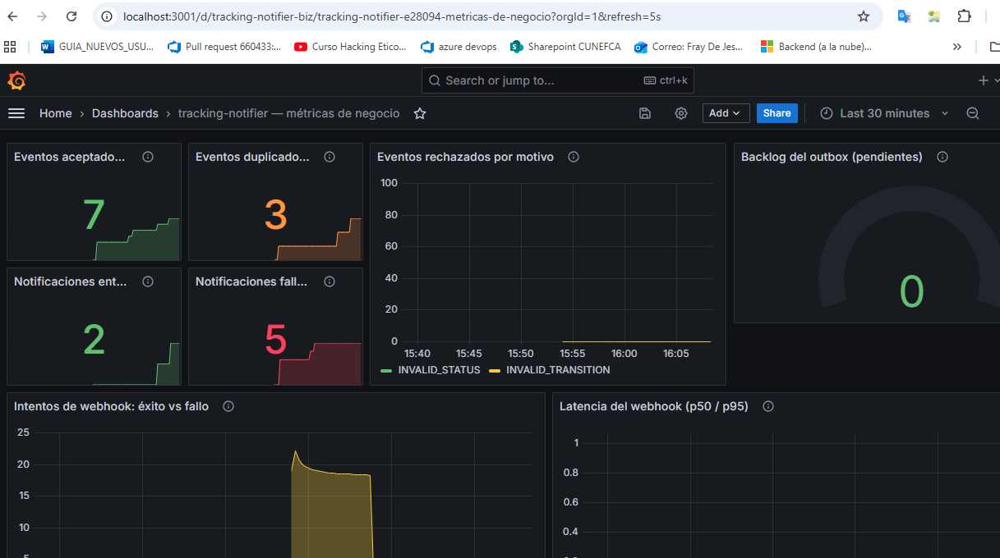
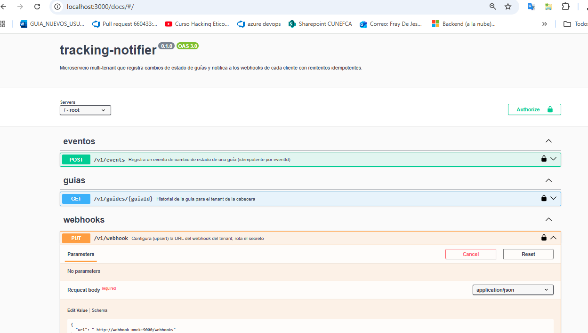
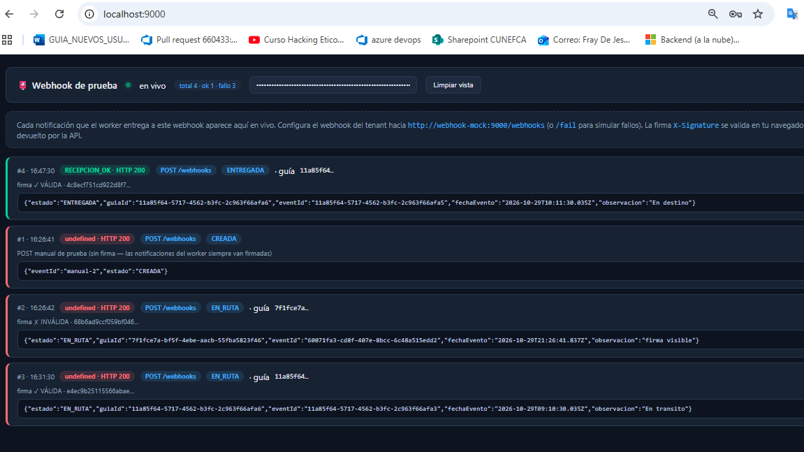

# tracking-notifier

Microservicio multi-tenant que **recibe cambios de estado de guías de envío**, los **persiste de
forma idempotente** bajo un **PostgreSQL**, y **notifica al webhook de cada cliente** de forma
asíncrona con reintentos (timeout 5 s, backoff creciente, 5 intentos, `FAILED` consultable).

Arquitectura **hexagonal** (dominio puro sin framework ni ORM) para la prueba técnica de
Desarrollador Backend Senior.

## Vista rápida

| | |
|---|---|
|  |
| *Grafana (:3001) — métricas de negocio en vivo: aceptados, duplicados, entregas y reintentos* |
|  |
| *Swagger UI (:3000/docs) — contratos ejecutables desde el navegador (Authorize con X-Tenant-Id)* |
|  |
| *Webhook de prueba (:9000) — entregas en vivo con validación de firma HMAC en el navegador* |

---

## Stack

| Componente | Elección |
|---|---|
| Runtime | Node.js 20+ · TypeScript estricto (`noUncheckedIndexedAccess`) |
| HTTP | Express 4 |
| Validación | Zod (también alimenta la spec OpenAPI) |
| Base de datos | PostgreSQL 16 · Drizzle ORM (SQL explícito, migraciones) |
| Logs | Pino (JSON estructurado, sin datos personales) |
| Pruebas | Vitest + Supertest · Integración con PostgreSQL real vía testcontainers |
| Observabilidad | Prometheus + Grafana (dashboard pre-cargado con métricas de negocio) |
| CI | GitHub Actions (`npm test` en cada push) |

## Cómo correrlo

### Con Docker (recomendado)

```bash
docker compose up
```

Levanta 5 servicios:

| Servicio | Qué hace |
|---|---|
| `api` (:3000) | El microservicio (API + worker del outbox) |
| `db` (:5432) | PostgreSQL 16 con migraciones automáticas al arranque |
| `webhook-mock` (:9000) | Webhook de prueba con **vista web en vivo** de las entregas; `/fail` falla intencionalmente para demostrar reintentos |
| `prometheus` (:9090) | Almacena y consulta las métricas que la API expone en `/metrics` |
| `grafana` (:3001) | Dashboard visual de métricas de negocio, pre-cargado |

**Accesos rápidos una vez arriba el compose**:

| URL | Qué es |
|---|---|
| http://localhost:3000/docs | Swagger UI (ejecuta la API desde el navegador) |
| http://localhost:9000 | Vista en vivo de los webhooks entregados |
| http://localhost:3001 | Dashboard Grafana (admin/admin) |
| http://localhost:3000/openapi.json | Especificación OpenAPI |
| http://localhost:3000/metrics | Métricas Prometheus crudas |
| http://localhost:3000/healthz | Health check |

### Local (desarrollo)

```bash
cp .env.example .env   # ajusta credenciales si hace falta
npm install
npm run db:migrate     # aplica migraciones
npm run dev            # API + worker en modo watch
```

## Cómo probarlo (guion de demostración)

### En un solo comando (requiere compose corriendo)

```bash
powershell -ExecutionPolicy Bypass -File scripts\demo.ps1
```

Recorre toda la historia observable: healthz → configuración del webhook → `201 ACEPTADO` /
`200 DUPLICADO` → `409` transición terminal → historial → ciclo `/fail` con backoff →
`FAILED` consultable → conteo de entregas en los logs del mock.

### Paso a paso con curl

```bash
# 1. Configura el webhook del tenant (simulado: el Gateway ya validó el tenant)
curl -X PUT http://localhost:3000/v1/webhook \
  -H "X-Tenant-Id: 11111111-1111-1111-1111-111111111111" \
  -H "Content-Type: application/json" \
  -d '{"url": "http://webhook-mock:9000/webhooks"}'

# 2. Registra un evento de estado (la respuesta no espera al webhook)
curl -X POST http://localhost:3000/v1/events \
  -H "X-Tenant-Id: 11111111-1111-1111-1111-111111111111" \
  -H "Content-Type: application/json" \
  -d '{
        "eventId": "0e5bcf6a-98d0-4f02-84b3-a5c9be7d2850",
        "guiaId": "c796dc3e-cad1-4c34-be0b-7c39e4391234",
        "estado": "CREADA",
        "fechaEvento": "2026-10-28T09:00:00.000Z",
        "observacion": "recibida en bodega central"
      }'
```

```bash
# 3. Idempotencia: reenviar el mismo eventId responde 200 DUPLICADO
#    (no se duplica el evento ni la notificación)
#    → repite el curl anterior y compara los códigos HTTP

# 4. Historial de la guía (orden cronológico, aislado por tenant)
curl http://localhost:3000/v1/guides/<guiaId> \
  -H "X-Tenant-Id: 11111111-1111-1111-1111-111111111111"

# 5. Observa las entregas en vivo: abre http://localhost:9000 en el navegador
#    (o en consola: docker compose logs -f webhook-mock)

# 6. Demuestra el ciclo de reintentos: configura el webhook hacia la ruta que falla
curl -X PUT http://localhost:3000/v1/webhook \
  -H "X-Tenant-Id: 11111111-1111-1111-1111-111111111111" \
  -H "Content-Type: application/json" \
  -d '{"url": "http://webhook-mock:9000/fail"}'
# registra un evento nuevo y observa los 5 intentos crecientes:
curl http://localhost:3000/v1/notifications?status=FAILED \
  -H "X-Tenant-Id: 11111111-1111-1111-1111-111111111111"
```

**Firma HMAC de los webhooks**: cada envío incluye `X-Signature: sha256=<hex>` donde
`hex = HMAC_SHA256(cuerpo_crudo, secreto_webhook)`; el secreto se genera y entrega cuando el
cliente configura su webhook (se puede rotar reconfigurando). El receptor valida recomputando
el HMAC del body crudo con su secreto.

## API (v1)

La especificación OpenAPI se sirve en **`GET /openapi.json`** (generada desde los mismos
esquemas Zod de validación) y está exportada como snapshot en `docs/openapi.yaml`.
Además, **Swagger UI interactivo** en **`http://localhost:3000/docs`** — permite ejecutar
cada endpoint directamente desde el navegador (recuerda poner el header `X-Tenant-Id`
mediante el botón *Authorize*, tipo *apiKey*).

| Método | Ruta | Descripción |
|---|---|---|
| `POST` | `/v1/events` | Registra evento de estado. `201` nuevo · `200` duplicado (idempotencia) · `409` transición inválida |
| `GET` | `/v1/guides/:guiaId` | Historial cronológico + estado actual (aislamiento por tenant) |
| `PUT` | `/v1/webhook` | Configura/rota la URL del webhook del tenant |
| `GET` | `/v1/notifications` | Consulta del outbox (`?status=PENDING|DELIVERED|FAILED`) |
| `GET` | `/metrics` | Métricas Prometheus de negocio: `tracking_eventos_*`, `tracking_notificaciones_*`, `tracking_webhook_*`, `http_requests_total` |
| `GET` | `/docs` | Swagger UI interactivo (consume `/openapi.json`) |
| `GET` | `/openapi.json` | Especificación OpenAPI |
| `GET` | `/healthz` | Health check |

**Cabecera obligatoria**: `X-Tenant-Id` (UUID). El Gateway simuló la autenticación del tenant.

**Formato único de error**:

```json
{ "error": { "code": "INVALID_TRANSITION", "message": "...", "details": [] } }
```

Códigos: `400 INVALID_PAYLOAD · INVALID_STATUS · INVALID_TENANT · INVALID_WEBHOOK_URL ·
INVALID_BODY`, `404 GUIDE_NOT_FOUND · NOT_FOUND`, `409 INVALID_TRANSITION`, `500 INTERNAL_ERROR`.

## Trazabilidad por requisito (cómo verificar cada uno)

| Requisito | Verificación automatizada | Verificación en vivo |
|---|---|---|
| **RF1** Registrar evento (idempotencia, transiciones) | Unit: `EstadoGuia`, `Guia`, `RegistrarEventoDeEstadoUseCase` (68 casos: dedup por eventId, dedup por contenido, re-escaneo enriquecido, terminales, regresiones, tardíos) · HTTP: supertest `events-api` · Integración: doble inserción concurrente en Postgres real | `scripts/verificar-reglas.mjs` |
| **RF2** Historial por guía (cronológico, aislado por tenant) | Unit: `ConsultarHistorialDeGuiaUseCase` (orden cronológico con repos desordenado, 404) · HTTP: `rutas-api` (404 cross-tenant) · Integración: aislamiento por tenant en Postgres real | demo.ps1 paso 5 |
| **RF3** Configurar webhook | Unit: `ConfigurarWebhookUseCase` (guardar, rotar secreto, URL http/s) · HTTP: `PUT /v1/webhook` · Integración: upsert real en Postgres + independencia por tenant | demo.ps1 paso 2 |
| **RF4** Notificar async (no bloquea, reintenta, FAILED consultable) | Unit: worker (entrega, backoff 1/2/4/8/16 s, 5 intentos→FAILED, sin webhook→FAILED) + dispatcher (HMAC-SHA256 verificado contra servidor real, 5xx, timeout) · **Integración e2e**: evento → notificación PENDING en BD real → worker → POST firmado verificado → `DELIVERED`; fallo ×5 → `FAILED` consultable vía listado; timeout; tenant sin webhook | demo.ps1 pasos 6–9 (`FALLO_INTENCIONAL ×5`, `RECEPCION_OK` con firma) |

Comando único: `npm test` (unitarias + integración contra PostgreSQL real vía testcontainers).

## Observabilidad (métricas)

- **Métricas visuales (Prometheus + Grafana)** — con `docker compose up` quedan disponibles:

  | Servicio | URL | Qué es |
  |---|---|---|
  | Grafana | **http://localhost:3001** (admin/admin) | Dashboard **"tracking-notifier — métricas de negocio"** ya cargado, con paneles en español |
  | Prometheus | http://localhost:9090 | Almacena las series; target `tracking-notifier` → `up` |
  | `/metrics` | http://localhost:3000/metrics | Exposición cruda (texto) que Prometheus raspea cada 5 s |

  Paneles del dashboard (se actualizan en vivo con la demo):

  | Panel | Métrica | Qué cuenta |
  |---|---|---|
  | Eventos aceptados (201) | `tracking_eventos_aceptados_total` | Eventos de guías aceptados y persistidos |
  | Eventos duplicados | `tracking_eventos_duplicados_total` | Ignorados por idempotencia (mismo eventId o contenido idéntico) |
  | Eventos rechazados por motivo | `tracking_eventos_rechazados_total{motivo}` | `transicion_invalida` (409), `estado_invalido`, `payload_invalido` (400) |
  | Notificaciones entregadas | `tracking_notificaciones_entregadas_total` | Webhooks entregados al cliente |
  | Notificaciones fallidas | `tracking_notificaciones_fallidas_total` | Agotaron 5 intentos → FAILED (consultable por API) |
  | Backlog del outbox | `tracking_notificaciones_en_bandeja` | Notificaciones PENDING ahora mismo |
  | Intentos de webhook éxito/fallo | `tracking_webhook_intentos_total{resultado}` | La historia de reintentos, en visual |
  | Latencia del webhook p50/p95 | `tracking_webhook_latencia_segundos` | Duración del POST al cliente |
  | Peticiones HTTP por ruta | `http_requests_total{route,status}` | Tráfico y códigos de la API |

  Para verlos moverse: corre `scripts/demo.ps1` (o los pasos manuales de arriba) y observa
  el panel de reintentos y el contador de fallidas crecer en tiempo real.

- **Decisión de diseño (observabilidad)**: elegimos el camino **métricas** del opcional del reto
  (Prometheus + Grafana, estándar de la industria, cero dependencia de SaaS). Se evaluó también
  trazas distribuidas (OpenTelemetry → Jaeger) —se implementó y se retiró por simplificación
  deliberada: el pipeline OTLP del SDK JS no fue confiable en este entorno y las métricas cubren
  el valor observacional que el sistema necesita (la trazabilidad fina por operación ya la dan
  los logs JSON estructurados con `eventId`/`tenantId`).

## El webhook de prueba tiene vista web (http://localhost:9000)

Abre **http://localhost:9000** y observa las entregas **en vivo** (Server-Sent Events),
sin consola:

- Cada notificación aparece como tarjeta con: número, hora, `RECEPCION_OK`/`FALLO_INTENCIONAL`,
  código HTTP, path, chip del estado de la guía y el body crudo pretty-printed.
- Pega el `webhookSecret` (el que devuelve `PUT /v1/webhook`) en el campo de la cabecera y cada
  tarjeta mostrará **✓ VÁLIDA / ✗ INVÁLIDA** para la firma `X-Signature` — la verificación HMAC
  que haría el sistema real del cliente, calculada en el navegador (Web Crypto, el secreto no
  sale de tu máquina).
- Contadores vivos (total / ok / fallo) e indicador de conexión; botón "Limpiar vista".
- La consola sigue logueando igual (`docker compose logs -f webhook-mock`) y la ruta `/fail`
  sigue fallando para demostrar reintentos.

```text
webhook-mock (compose) → GET /  (vista) · GET /eventos (SSE) · GET /entregas (historial)
                         POST *  → registra la entrega, responde 200 (o 500 en /fail)
```

## Pruebas

```bash
npm test          # todo (unitarias + integración) en un solo comando
npm run test:unit         # solo unitarias (no requieren Docker)
npm run test:integration  # solo integración (PostgreSQL real vía testcontainers)
```

Qué se prueba y por qué:

- **Dominio (unitarias)**: máquina de estados (`EstadoGuia`): transiciones válidas, terminales
  (`ENTREGADA`/`DEVUELTA` rechazan todo), validez de estados de negocio. Es la regla más
  valiosa del producto → código completamente testado.
- **Casos de uso**: idempotencia por `eventId`, que la transición inválida no persiste nada, que
  el evento aceptado crea su notificación `PENDING` en la misma transacción (outbox), que el
  historial ordena cronológicamente aunque el repos devuelva desordenado, aislamiento de tenant.
- **Worker del outbox**: entrega feliz → `DELIVERED`; fallo → reprograma con espera exponencial
  (1 s, 2 s, 4 s…); 5 intentos → `FAILED` consultable y sin más reintentos; tenant sin webhook →
  `FAILED` con error descriptivo.
- **Firma**: el dispatcher envía `X-Signature` correcta sobre el cuerpo crudo; servidor HTTP real
  actuando de cliente para verificación end-to-end.
- **Integración (PostgreSQL real)**: los repos Drizzle con `UNIQUE(tenant_id, event_id)` y
  `ON CONFLICT DO NOTHING` — incluyendo **doble inserción concurrente** (`Promise.all`), que es
  como el reto puede exprimir la condición de carrera en producción.

## Arquitectura (hexagonal — puertos y adaptadores)

```text
src/
  domain/                   # SIN imports de frameworks, ni Express, ni Drizzle
    guia/                   # EstadoGuia (máquina de estados), EventoDeEstado, Guia
    notificacion/           # Notificacion, PoliticaDeReintentos
    webhook/                # ConfiguracionWebhook
    ports/                  # GuiaRepository, NotificacionRepository,
                            # ConfiguracionWebhookRepository, DespachadorDeWebhook,
                            # Reloj, Transaccion
    errors.ts               # errores de negocio con código HTTP (formato único)
  application/
    use-cases/              # RegistrarEventoDeEstado, ConsultarHistorialDeGuia,
                            # ConfigurarWebhook, ListarNotificaciones,
                            # DespacharNotificacionesPendientes (worker)
  infrastructure/
    http/                   # Express: rutas, validación Zod, middleware tenant,
                            # formato de error único, openapi (desde Zod)
    persistence/            # Drizzle: esquema, migraciones, repos, proveedor de
                            # transacción real (outbox atómico)
    webhooks/               # HttpWebhookDispatcher (fetch + HMAC + timeout)
    worker/                 # CicloDelWorker (polling del outbox)
    config/                 # env fail-fast (Zod), logger Pino
  container.ts              # composición e inyección de dependencias manual
```

La **regla de dependencia** es estricta: `domain` y `application` no importan nada de
`infrastructure`; los adaptadores implementan los puertos de dominio. `container.ts` ensambla
todo al arranque (inyección explícita, sin contenedor mágico).

## Decisiones y supuestos

1. **`guiaId` en el cuerpo del evento** — el enunciado no lo declara pero sin él es imposible
   agrupar el historial por guía ni aplicar la máquina de estados. Se asume que viene en el payload
   (`guiaId: UUID`). Primera decisión de dominio documentada.
2. **Outbox como corazón del sistema** — ver `docs/adr-001.md` (cuadro de alternativas y consecuencias).
3. **Idempotencia** — la garantía fuerte se implementa **en la base de datos** (`UNIQUE` + `ON
   CONFLICT DO NOTHING`), no solo en código de aplicación: es la única manera de vencer la
   condición de carrera de doble envío. El caso de uso consulta primero y devuelve
   `DUPLICADO → 200` sin duplicar evento ni notificación.
4. **Estados terminales y reglas de transición** — la máquina de estados actúa en dos niveles:
   - **Terminales en absoluto**: `ENTREGADA` y `DEVUELTA` rechazan **cualquier evento nuevo** con
     `409 INVALID_TRANSITION` — incluso uno tardío con `fechaEvento` anterior al estado final, o un
     `ENTREGADA→ENTREGADA` repetido con datos nuevos. No se permite backfill bajo estado final.
     La única respuesta sin 409 es el reenvío del **mismo `eventId`** ya registrado, que responde
     `200 DUPLICADO` por idempotencia (no es un evento nuevo: no cambia nada).
   - **Regresión en tiempo real bloqueada**: `EN_RUTA → CREADA` con `fechaEvento` posterior al
     vigente se rechaza con `409` (una guía no "vuelve a nacer").
   - **Deduplicación por contenido** (estados no terminales): un evento nuevo cuyo estado,
     `fechaEvento` y `observacion` son **idénticos** al evento vigente se responde
     `200 DUPLICADO` sin persistir nada (misma lectura reenviada con otro `eventId`).
   - **Re-escaneo enriquecido**: mismo estado con `fechaEvento` u `observacion` distintas se
     acepta (`201`) como lectura nueva + su notificación.
5. **Eventos fuera de orden (inserciones históricas)** — la secuencia lógica del dominio es la
   **`fechaEvento` + estado**, no el orden de llegada:
   - Un evento con `fechaEvento` **anterior** al vigente se acepta como **inserción histórica**:
     se posiciona cronológicamente en el historial y el `estadoActual` **no cambia** (sigue siendo
     el del evento con mayor `fechaEvento`).
   - Coherencia exigida: el estado del tardío debe poder transicionar hacia el estado del evento
     que le sigue en el tiempo (ej: insertar `CREADA` antes de `EN_RUTA` es válido; insertar
     `ENTREGADA` antes de `EN_RUTA` sería incoherente → `409 INVALID_TRANSITION`).
   - Un evento tardío aceptado **sí genera su notificación webhook** ("por cada evento aceptado
     se notifica" — para el tenant es información nueva aunque histórica).
   - El primer evento de una guía nueva puede ser cualquier estado no terminal (una guía puede
     iniciar directamente en `EN_RUTA`).
6. **Estado actual de la guía** — es el del evento con `fechaEvento` más reciente
   (desempate por `fechaRegistro`), coherente con el historial cronológico. Fijado en el
   agregado: "vigente" tiene una única definición en el dominio.
7. **Tenant** — `X-Tenant-Id` se confía (simulado por Gateway); el servicio verifica formato UUID,
   no existencia. El tenant nace a la hora de configurar su webhook; toda lectura/escritura filtra
   por tenant y las `UNIQUE` están por `(tenant_id, …)`.
8. **Notificaciones de tenants sin webhook** — se marcan `FAILED` con error descriptivo y quedan
   consultables (es el comportamiento con menos esquinas y más observabilidad).
9. **Secretos** — exclusivamente por variables de entorno (validadas con Zod al arrancar:
   *fail-fast*). Nada sensible en el repo; `.env.example` documenta el contrato. Credenciales de
   compose son ficticias (solo demo).
10. **Logs** — JSON por línea (Pino) con `redact` de cabeceras sensibles; se registran
    identificadores (`tenantId`, `eventId`) y resultados, **nunca** cargas útiles ni `observacion`
    (candidato real a contener datos personales).

## Herramientas de IA utilizadas

- **Asistente de codificación (GLM 5.3 Flash, vía opencode CLI) para andamiaje acelerado**:
  estructura del proyecto, configuración TypeScript, esqueleto Express/Drizzle, y redacción de
  los primeros tests para bootstrapping por TDD. El **diseño** (máquina de estados, outbox,
  contratos HTTP) y las decisiones del ADR salieron del análisis del enunciado.
- **Depuración incrementada**: el asistente ayudó a identificar el error de entorno OpenSSL de
  npm en Windows (workaround documentado en scripts) y a corregir detalles de tipado estricto.
- Todo el código final fue revisado, ejecutado y testeado localmente; las pruebas
  describen el comportamiento esperado de negocio y las aserciones son verificables.

## Qué haría con más tiempo

- **`LISTEN/NOTIFY`** del outbox para entrega casi-inmediata sin sacrificar durabilidad
  (polling mantiene su rol de red de seguridad).
- **Trazas distribuidas (OpenTelemetry)** propagadas por `eventId` — la pieza de observabilidad
  pendiente: hoy la trazabilidad fina por operación la dan los logs JSON estructurados.
- **Rate limiting y desduplicación** adicional por tenant en el dispatcher, y circuit breaker
  si un webhook se cae prolongadamente (aplicar un retraso mayor a `next_attempt_at`).
- **Paginación por cursor** en `/v1/notifications` (offset basta para el alcance actual).
- **Readiness y liveness separadas** y health-check que refleje la salud del worker.
- **E2E contra la API en compose** (el webhook mock ya está listo para estos tests).
- **Lint en CI** con ESLint riguroso (reglas de fronteras de arquitectura con `eslint-plugin-boundaries`).
